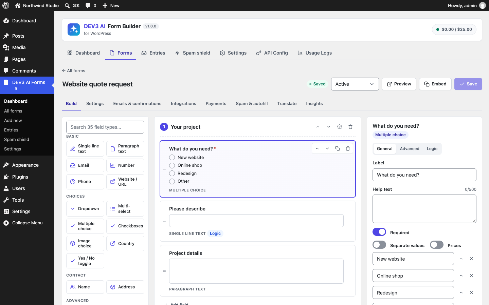

# DEV3 AI Form Builder for WordPress

Drag-and-drop form builder with 35 field types, multi-step forms, conditional logic, calculations, Stripe/PayPal payments, entries, integrations and DEV3 AI: describe a form in one sentence, score leads, draft replies, find drop-off and translate forms.



## Features

**Builder**
* Drag-and-drop builder with 35 field types: text, paragraph, email, number, phone, URL, dropdown, multi-select, multiple choice, checkboxes, image choice, country, yes/no toggle, name, address, date, time, file upload, signature, star rating, NPS, opinion scale, slider, colour, password, hidden, consent, calculation, product, quantity, custom amount, order total, heading, text block, divider.
* Multi-step forms with progress bar or step names, step-level and field-level conditional logic (show/hide, all/any, 12 operators).
* Live calculations with a safe formula engine (+ − × ÷, min, max, round, if…), recomputed on the server.
* Half/third widths, default values with merge tags ({user:email}, {query:utm_source}…), 8 templates, JSON import/export.

**Entries & delivery**
* Entries manager: inbox, unread, starred, awaiting payment, spam and trash; search, bulk actions, notes, activity log, CSV export.
* Email notifications with conditional logic, merge tags, Reply-To/Cc/Bcc and attachments; conditional confirmations (message, page or redirect).
* Integrations: Mailchimp, Brevo, HubSpot, Google Sheets (Apps Script web app), Zapier and signed webhooks.
* Payments: Stripe Checkout and PayPal (redirect flows, no card data on your site). Amounts are always recalculated on the server.
* File uploads stored privately (never public URLs), signatures, save-and-continue-later links, entry limits, schedules, login-only forms.

**Spam & autofill** (from DEV3 AI Form Autofill & Spam Shield)
* Honeypot, time trap and rate limit without CAPTCHA.
* DEV3 AI Spam Shield: reads each message like a person; spam is kept, blocked or flagged. Fail-open/closed, sender allowlist, privacy-first log.
* DEV3 AI Paste-to-fill: visitors paste an email signature and the empty fields are filled for them to check.

**DEV3 AI**
* Describe your form: one sentence becomes a complete multi-step form with options, logic and calculations, shown as a draft first.
* Entry intelligence: summary, sentiment, intent, category, urgency and a 0-100 lead score per entry (rule-based score without AI).
* AI auto-replies: a reply in the sender's language that you edit and approve before it is sent.
* Conversion advice: funnel, drop-off per field and fixes you preview and apply.
* Smart translation of fields, options, buttons, confirmations and validation messages; served automatically per site language, WPML or Polylang.

AI runs on Google AI with your own API key, which never leaves your server. Every AI result that changes data is shown as a draft first. The plugin is fully usable without a key.

## Requirements

- WordPress 6.0 or newer (tested up to 6.8)
- PHP 7.4 or newer
- Optional: your own Google AI API key (from Google AI Studio) to switch on the DEV3 AI features. The rest of the plugin works without one.

## Installation

### From the release zip

1. Download `dev3-ai-form-builder.zip` from the [latest release](https://github.com/dev3tech/dev3-ai-form-builder/releases/latest).
2. In WordPress, go to **Plugins → Add New → Upload Plugin**, choose the zip and click **Install Now**.
3. Click **Activate**.

### Build from source

```bash
git clone https://github.com/dev3tech/dev3-ai-form-builder.git
cd dev3-ai-form-builder
composer install --no-dev
npm ci
npm run build
```

Then copy the `dev3-ai-form-builder` folder into `wp-content/plugins/` and activate it.

### Getting started

1. Upload the plugin zip in Plugins → Add New → Upload, then activate.
2. Open **DEV3 AI Forms** and create a form (template, blank or "Describe a form").
3. Add the **DEV3 AI Form** block to a page, or paste the shortcode `[dev3fb_form id="123"]`.
4. Optional: add a Google AI API key in DEV3 AI Forms → API Config to turn on the AI features.

## FAQ

### Does it work without AI?
Yes. The builder, logic, calculations, payments, entries, integrations and the honeypot/time-trap spam protection need no API key.

### Which data is sent to Google AI?
Only what a feature needs: for spam checks and insights, the text answers (emails reduced to their domain; phone numbers, passwords and files are never sent). See the Privacy section of the documentation.

### Does it work with page caching?
Yes. Forms use a signed token instead of nonces and refresh it when a cached page is very old.

### Which page builders are supported?
The block editor (native block) and any builder that accepts shortcodes (Elementor, WPBakery, Divi, classic editor, widgets).

## Privacy

AI features send data to Google AI under your own API key. A privacy-policy snippet is added under Settings → Privacy, and form entries are included in WordPress's personal data export and erase tools.

## Documentation

The full HTML guide (installation, settings, hooks and FAQ) is in [`docs/index.html`](docs/index.html). Open it in a browser after cloning or downloading the repository.

## Changelog

### 1.0.0
* First release.

## Licence

Released under the GNU General Public License v2.0 or later (GPL-2.0-or-later). See [LICENSE](LICENSE).

## More from DEV3

- [DEV3 AI Form Builder for WordPress on the DEV3 Marketplace](https://www.dev3.tech/item/dev3-ai-form-builder)
- [More WordPress plugins, themes and templates from DEV3](https://www.dev3.tech/marketplace)
